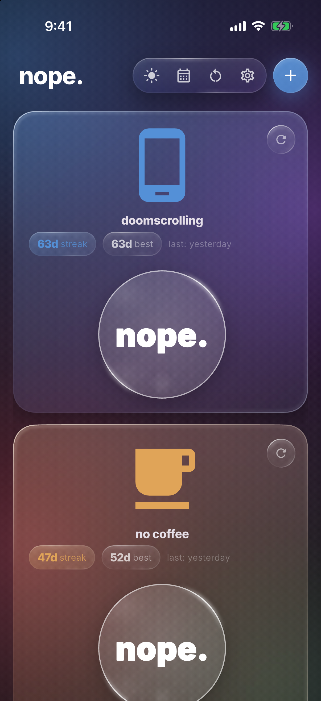
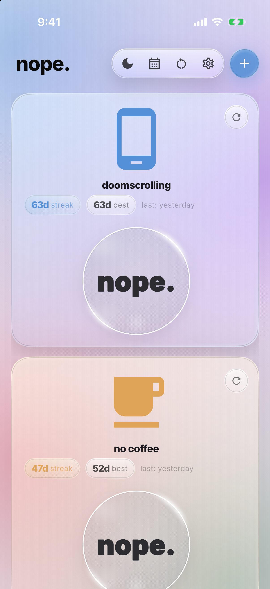
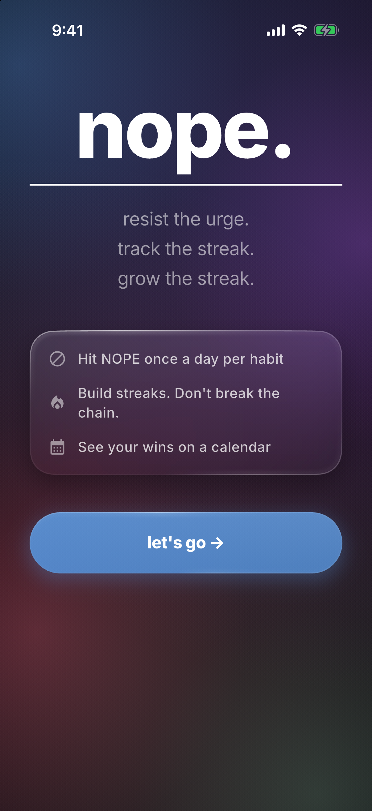
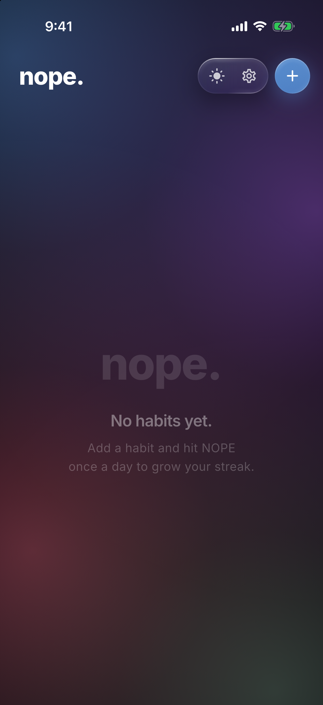

# nope.

A cross-platform mobile app (currently in beta) that helps you resist impulses and break bad habits. Each day you hold out, you hit **NOPE** and your streak grows.

  
  
  

## Key Features

- **Liquid-glass design:** Frosted-glass cards, buttons and dialogs throughout, with a bundled Inter typeface.
- **Light & dark mode:** Switch between them from the home screen. Your choice is remembered.
- **The NOPE button:** Tap once a day per habit. A red X is drawn, then a poof, then a check, and the streak goes up.
- **Done-today stack:** Habits you've already handled for the day move down into a "Done today" stack. When everything is done, you get an "All clear for today" card.
- **Streaks:** Tracks your current and best streak for each habit. If you miss a day, the streak resets.
- **Custom habits:** Pick a name, a starting streak, a color (preset swatches or a full RGB picker) and an icon (coffee, phone, junk food, smoking, drinking, gaming, shopping and more).
- **Calendar view:** A monthly calendar that marks every day you resisted.
- **Safe resets:** Reset one habit or all of them. A two-step confirmation guards against accidental resets.
- **Daily reminder:** A local notification at 8 PM, plus an in-app banner in the evening for habits that still need a NOPE.
- **App lock:** An optional 4-digit passcode (stored as a SHA-256 hash), with Face ID / fingerprint unlock.
- **Persistent storage:** Habits, streaks and history are saved on the device with `SharedPreferences`.
- **Cross-platform:** Built with Flutter for iOS and Android, with tablet scaling.

## Screenshots

| Intro | Empty state | Home (dark) | Home (light) |
|:---:|:---:|:---:|:---:|
|  |  |  |  |

## Tech Stack

- **Flutter & Dart** for the UI and cross-platform support
- **SharedPreferences** for on-device storage
- **TableCalendar** for the calendar view
- **flutter_local_notifications** + **timezone** for the daily reminder
- **local_auth** + **crypto** for the app lock
- **Maestro** flows (`maestro/`) for capturing marketing screenshots

## Status

Currently in beta testing. A demo and the source code are available on request.

## License

All rights reserved. Shared for portfolio and demonstration purposes only. No permission is granted to use, copy, modify, or distribute this code.
